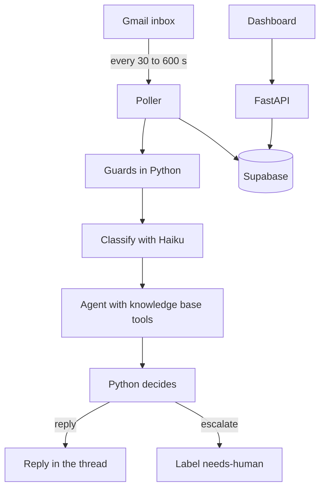

# AI agent Customer Support for a company/business

Automate the customer support of a company/business with Gmail, Supabase, and OpenAI models through Pydantic AI, then deploy it with Docker using Hostinger VPS.

Automate the entire customer support of a company/business. A backend checks a Gmail inbox, an AI pipeline reads each email, searches a knowledge base, and then replies or hands the email to a person. It runs on our own server, and nothing on that server is reachable from the internet except SSH from your IP address.

It is a full-stack GenAI project, from an empty folder to a deployed system with a dashboard.


## How it works



A poller asks Gmail for new mail on a fixed interval. Every email and every event is saved in Supabase. Guards in plain Python stop the bot from answering itself. A small model classifies the email, a larger model drafts the answer with tools that read the knowledge base, and Python makes the final call. The model proposes, code decides.

## Run it locally

Three processes need to run at the same time, one per terminal.

Prerequisites:

```bash
uv sync
cp .env.example .env # then fill in Supabase DATABASE_URL and Google/OpenAI credentials
cd dashboard && npm install
```

Terminal 1 — backend (FastAPI, port 8000):

```bash
uv run uvicorn app.main:app --reload --port 8000
```

Terminal 2 — poller (Gmail to AI pipeline, every `POLL_INTERVAL_SECONDS`):

```bash
uv run python -m app.poller
```

Terminal 3 — frontend (Vite dev server, port 5173):

```bash
cd dashboard && npm run dev
```

Then open http://localhost:5173. The dev server proxies `/api` to the backend on port 8000, and the dashboard login uses `DASHBOARD_USERNAME` / `DASHBOARD_PASSWORD` from `.env`.

For a production-style build instead, run `npm run build` in `dashboard/` and open http://localhost:8000 — FastAPI serves the built dashboard there.

## Run with Docker Compose

You do **not** need Python, `uv`, Node or npm installed locally to run the app. The `Dockerfile` builds everything inside the image in two stages:

1. `node:20-alpine` runs `npm ci && npm run build` to produce `dashboard/dist/`.
2. `python:3.13-slim` installs Python dependencies with `uv`, copies `app/` and `knowledge_base/`, copies the built dashboard from stage 1, and starts `uvicorn app.main:app --host 0.0.0.0 --port 8000`.

`docker-compose.yml` builds that image from the repository source (`build.context: .`), maps `8000:8000`, injects `.env` via `env_file`, restarts the container unless stopped, and health-checks `GET /health`.

So yes — Compose builds and starts the app automatically:

```bash
cp .env.example .env    # fill in DATABASE_URL, Google and OpenAI credentials, DASHBOARD_PASSWORD
docker compose up --build
```

Then open http://localhost:8000 and log in with `DASHBOARD_USERNAME` / `DASHBOARD_PASSWORD` from `.env`.

Useful variants:

```bash
docker compose up --build --detach   # run in the background
docker compose logs -f app           # follow logs
docker compose down                  # stop and remove the container
```

Without `--build`, Compose reuses an already-built image. Use `--build` **every time you change code** — that is how contributors and forks pick up their edits without installing any toolchain locally. There is no published image configured in this repo; if you publish one, replace the `build:` block in `docker-compose.yml` with `image: <your-image>:<tag>`.

Two things Compose does **not** do for you:

- **Database setup.** Apply the SQL in `supabase/migrations/` to your Supabase project first (SQL Editor or Supabase CLI). Then seed the knowledge base from the host with `uv sync && uv run python scripts/seed_knowledge_base.py`. The image does not contain `scripts/`, so it cannot run that helper itself. You can also edit knowledge-base rows later from the dashboard.
- **Gmail polling.** The container starts only the web process. Run `uv run python -m app.poller` separately on the host (or on your VPS) to check the inbox on an interval. The dashboard's "Check inbox now" button currently fails because of a backend bug — use the poller instead.

> Note: the frontend build stage uses `node:20-alpine`. Vite 8 requires Node `^20.19.0 || >=22.12.0`, so pin that tag to a newer patch/release if a build fails on an older Node 20 image.

## Full setup guides

Step-by-step details for each part live in [`docs/guide_setup/`](docs/guide_setup/):

- [`backend_setup.md`](docs/guide_setup/backend_setup.md) — dependencies, `.env`, Google OAuth, running, evals, known issues.
- [`frontend_setup.md`](docs/guide_setup/frontend_setup.md) — Node/npm, dev/build commands, API proxy.
- [`supabase_setup.md`](docs/guide_setup/supabase_setup.md) — migrations, RLS, `DATABASE_URL`, seeding.