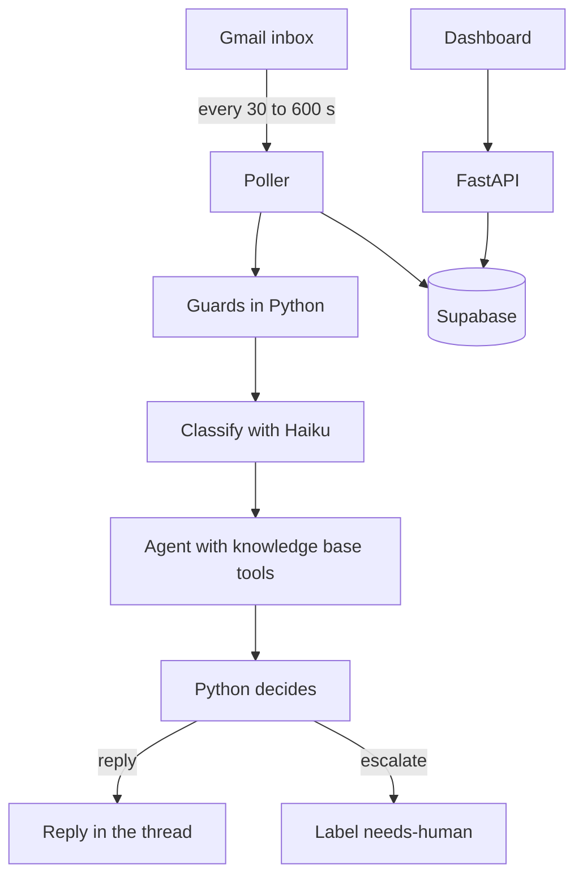

# AI agent Customer Support for a company/business

Automate the customer support of a company/business with Gmail, Supabase, and OpenAI models through Pydantic AI, then deploy it with Docker using Hostinger VPS.

Automate the entire customer support of a company/business. A backend checks a Gmail inbox, an AI pipeline reads each email, searches a knowledge base, and then replies or hands the email to a person. It runs on our own server, and nothing on that server is reachable from the internet except SSH from your IP address.

It is a full-stack GenAI project, from an empty folder to a deployed system with a dashboard.

## How it works

A poller asks Gmail for new mail on a fixed interval. Every email and every event is saved in Supabase. Guards in plain Python stop the bot from answering itself. A small model classifies the email, a larger model drafts the answer with tools that read the knowledge base, and Python makes the final call. The model proposes, code decides.